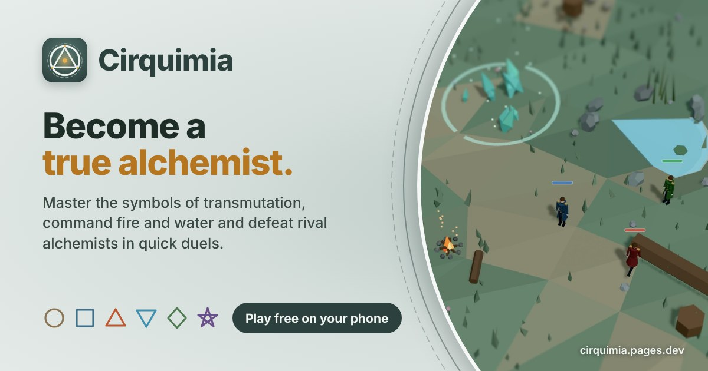
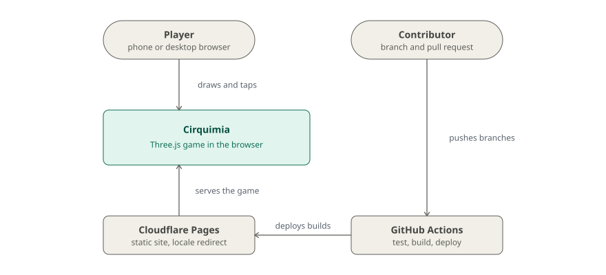

# Cirquimia

**Draw transmutation circles with your finger and duel rival alchemists in a tiny low-poly meadow, free in the browser.**

[](https://github.com/glrodasz/cirquimia/actions/workflows/deploy.yml) [](LICENSE) [](https://threejs.org/) [](https://www.typescriptlang.org/) [](https://vite.dev/)

<br clear="left">

[**▶ Play at cirquimia.pages.dev**](https://cirquimia.pages.dev) · [How to play](#how-to-play) · [How it works](#how-it-works) · [Architecture](#architecture) · [Quick start](#quick-start)



## Why

Most phone games hide their spells behind buttons. In Cirquimia the spell *is* the gesture: you play a state alchemist dropped into a procedurally generated meadow that looks like a miniature diorama, and every attack, wall and heal comes from a symbol you draw on the screen. Sketch a square and the earth erupts under your rival; draw a circle and a stone wall rises in front of you.

It is built for phones in portrait and plays with a mouse and keyboard too. It runs in any modern browser with WebGL 2, with no install and no account, in English and in [Spanish](https://cirquimia.pages.dev/es).

| Principle | In practice |
| --- | --- |
| Draw to cast | A geometric recognizer reads one-stroke shapes and snaps your ink to a clean symbol. No buttons, no menus. |
| One symbol in hand | You hold one symbol at a time; drawing a new one replaces it. No inventory, no ammo bar. |
| A new meadow every match | Terrain, trees, ponds, campfires, ruins and rune circles are generated from a seed. |
| The terrain matters | Fire is charged at a campfire, water at a lagoon, and rune circles boost your spells. |
| Fast on mid-range phones | Instanced meshes (about 15 draw calls for the whole meadow), one shadow light, a two-pass post effect. |

## Quick start

Requirements: Node.js 20.19+ or 22.12+ (what Vite 8 needs) and npm.

```bash
git clone https://github.com/glrodasz/cirquimia.git
cd cirquimia
npm install
npm run dev            # http://localhost:5173, also exposed on your LAN to test on a phone
```

| Command | What it does |
| --- | --- |
| `npm run dev` | Dev server with hot reload |
| `npm test` | Unit tests (Vitest): stroke recognizer, pointer router, keyboard walking, aim reticle |
| `npm run build` | Type-checks and builds to `dist/` |
| `npm run build:single` | Builds `dist/cirquimia-single.html`, the whole game in one self-contained file |
| `npm run preview` | Serves the production build |

## How to play

1. **Tap the ground** to walk. On a desktop, walk with <kbd>W</kbd><kbd>A</kbd><kbd>S</kbd><kbd>D</kbd> or the arrow keys, or click the ground.
2. **Draw a symbol** anywhere with one stroke. It goes straight into your hand and shows over the alchemist's head. Walls (circle) and heals (rhombus) go off at once.
3. **Tap a target** to cast the symbol in hand. Tap the alchemist to drop it instead.

Drawing a new symbol replaces the one in hand, so a square followed by a triangle leaves you holding the triangle.

| Symbol | Spell | Effect |
| --- | --- | --- |
| Circle | Muro (wall) | Raises an earth wall around you, facing where you tap; other fighters' strikes into its zone are blocked, yours go through |
| Square | Tierra (earth) | Stone pillars erupt at the target: 20 damage |
| Triangle ▲ | Fuego (fire) | 35 damage. Draw it over a campfire (fogata) to charge it |
| Triangle ▼ | Agua (water) | 35 damage. Draw it over a lagoon (laguna) to charge it |
| Rhombus ◆ | Cura (heal) | Restores 25 HP |
| Pentagram ★ | Estrella (star) | Five strikes around the target, 10 damage each; good for hitting several rivals |

**Runes.** Cast from inside a rune circle on the ground and your power grows: +25% strike area, and heals restore 33 instead of 25. Walls cannot be raised inside one, so nobody can turtle up there.

A fighter at 0 HP falls. Knock out every rival for **¡Victoria!**; fall yourself and it is **Game Over**. Each new game starts on a new meadow. The two pills at the bottom left set the number of rivals (0 to 2, free-for-all) and the difficulty (Easy, Normal, Hard, Very hard); the book at the bottom right reopens the guide. A first visit goes straight into the first match, which teaches by playing: walk to a mark, draw a square, raise a wall, then hints over the campfire and the lagoon until fire and water have been charged once. The "?" opens a three-page guide (move, draw, cast).

## How it works

The game is plain TypeScript on top of Three.js, with no game engine. Four pieces do the work:

| Piece | What happens |
| --- | --- |
| **Strokes** (`src/pointer.ts`, `src/gestures.ts`, `src/ink.ts`) | The pointer router tells taps from drawings finger by finger (a press that wanders less than 40 px is a tap). A finished stroke is resampled, smoothed, trimmed where it runs past its start, then classified with plain geometry: radius spread and sweep for a circle, corner angles and side ratios for triangles, squares and rhombi, tip angles for the pentagram. No templates, no training. The ink then snaps to the ideal shape. |
| **Meadow** (`src/generator.ts`, `src/features.ts`, `src/world.ts`) | From a seed the generator picks and places features per material (stone, earth, water, fire, magic, ruins) plus a trail. The world flood-fills from the spawn to measure what is walkable and drops the most blocking feature until enough of the meadow is reachable. |
| **Combat** (`src/combat.ts`, `src/spells.ts`, `src/match.ts`) | HP, damage, the rune bonus and the rival AI. Rivals walk, dodge, heal, raise walls and draw their own symbols; each difficulty tunes their speed, cooldowns, aim error and reaction time. |
| **Rendering** (`src/main.ts`, `src/meadow.ts`, `src/tiltShift.ts`) | A fixed camera at a 54° pitch and 24° yaw, flat-shaded Lambert materials, and a tilt-shift blur that makes the meadow read as a tabletop model. |

Before the game loads, `src/gpu.ts` probes WebGL 2 and explains how to turn on hardware acceleration when the browser falls back to a software renderer.

## Architecture

<picture>
  <source media="(prefers-color-scheme: dark)" srcset="docs/diagrams/context-dark.svg">
  
</picture>

Cirquimia is a static site: the whole game runs in the player's browser, and there is no game server or account. Cloudflare Pages serves the build and runs one edge function (`functions/_middleware.ts`) that sends a first visit to `/` on to `/es` when the browser or a saved `locale` cookie asks for Spanish.

GitHub Actions (`.github/workflows/deploy.yml`) runs the tests and the build on every push. `main` deploys to [cirquimia.pages.dev](https://cirquimia.pages.dev); every pull request gets its own preview URL, posted as a sticky comment on the PR, and branch `foo/bar` is served at `https://foo-bar.cirquimia.pages.dev`. Deploys use the repo secrets `CLOUDFLARE_API_TOKEN` and `CLOUDFLARE_ACCOUNT_ID`; without them the workflow only builds.

**Tech stack:** rendering [Three.js](https://threejs.org/) (WebGL 2) · language TypeScript · build [Vite](https://vite.dev/) · tests [Vitest](https://vitest.dev/) · font Alegreya (self-hosted via Fontsource) · hosting Cloudflare Pages + GitHub Actions.

## Configuration

Handy URL parameters:

| Parameter | Effect |
| --- | --- |
| `?seed=anything` | Reproduces a meadow |
| `?look=glade` | Switches to the warm Glade look (Bruma is the default) |
| `?tutorial` | Replays the first-match tutorial and the fire and water hints |
| `?dev` | Shows the gear with the developer panel: new meadow, seed, generator sliders, tilt-shift and FPS toggles, look switch |
| `?gpu=none` / `?gpu=software` | Forces the hardware-acceleration notice, for testing |

<details>
<summary>Tuning knobs</summary>

- Meadow generation: defaults in `DEFAULT_PARAMS` (`src/generator.ts`); playable area in `PLAY_AREA` (portrait only: everything is placed inside the vertical phone frame).
- Camera angle and zoom: `ELEVATION`, `AZIMUTH`, `FOV`, `VIEW_HEIGHT_LANDSCAPE`, `VIEW_WIDTH_PORTRAIT` in `src/main.ts`.
- Walk speed: `SPEED` in `src/character.ts`.
- Drawing vs tapping: `DRAW_THRESHOLD` and `TAP_SLOP` in `src/pointer.ts`. Recognizer tolerances at the top of `src/gestures.ts`.
- Rival behaviour per difficulty: the difficulty table in `src/combat.ts`.
- Miniature blur: `band` and `strength` uniforms in `src/tiltShift.ts`.

</details>

<details>
<summary>Performance choices</summary>

- Every repeated prop is one `InstancedMesh` (about 15 draw calls for the whole meadow).
- Flat-shaded Lambert materials, one shadow-casting light. The shadow box is fitted to the ground the screen shows and the map sized to keep the same texel size (48/1024 units on touch, 48/2048 on desktop), so shadows look the same at a fraction of the map.
- The camera never moves: instances farther than `VISIBLE_RADIUS` (`src/world.ts`) are dropped after generation.
- The scene is drawn once into a 4x MSAA half-float target (no canvas MSAA); horizontal blur, then vertical blur straight to the canvas, which also tone maps (no separate output pass). Inside the focus band the blur reads one texel.
- Pixel ratio capped at 2; the tilt-shift pass can be toggled off from the dev panel.

</details>

### Project layout

```
src/            game code (one module per system, listed below)
src/i18n/       UI strings in English and Spanish, locale routing, per-language page metadata
src/assets/     images for the in-game guide
tests/          Vitest unit tests and recorded strokes
functions/      Cloudflare Pages edge middleware (language redirect)
public/         favicon set, app icons, web manifests, link preview cards (og/)
scripts/        brand renderer (icons, OG cards) and the single-file build
estilos/        earlier visual style experiments (diorama, pixel art, engraving, palettes)
play/           an early single-file build of the meadow prototype
docs/           diagrams
```

<details>
<summary>Every module in <code>src/</code></summary>

| File | What it does |
| --- | --- |
| `main.ts` | Renderer, camera framing, lights, input, game loop |
| `boot.ts` | Entry point: checks for WebGL 2 on the graphics card, then loads the game |
| `generator.ts` | Procedural meadow: from a seed, picks and places features per material (roca, tierra, agua, fuego, magia, restos) plus a trail. Pure data, plus the generator parameters |
| `features.ts` | Builds each feature (menhir ring, wall, boulders, pond, campfire, crystals, rune circle, palisade, cart, logs, banner), batched into a few InstancedMeshes |
| `world.ts` | Generates/rebuilds the meadow, checks walkability (flood fill from the spawn) and drops the most blocking feature until enough is walkable |
| `meadow.ts` | Terrain, trees, rocks, grass, flowers, mushrooms (all instanced) |
| `look.ts`, `glade.ts` | Bruma (default) and Glade looks; the Glade shader touch |
| `character.ts` | The alchemist: build, walk animation, obstacle sliding, falling and getting up |
| `path.ts` | Pathfinding around obstacles |
| `pointer.ts` | Tells taps from drawings, finger by finger |
| `keys.ts`, `keysHint.ts` | WASD / arrow-key walking and the keycap hint on desktop |
| `gestures.ts` | Single-stroke shape recognizer (geometry, no templates) |
| `ink.ts` | 2D overlay for the stroke, the shape snap and the flash |
| `ammo.ts` | Brush-stroke symbol icons shared by the HUD, guide and tutorial |
| `aim.ts` | Reticle under the mouse showing the ground a held strike would cover |
| `spells.ts` | Spell visuals: earth wall, pillars, fire, water, heal, star |
| `combat.ts` | HP, damage, rune bonus, rival AI and difficulty levels, win/lose |
| `match.ts` | Match HUD (rivals, difficulty), end-of-match cards, restart on a new meadow |
| `help.ts` | "How to play" guide |
| `tutorial.ts` | Interactive first-match tutorial |
| `sourceHints.ts` | Fire and water hints over the campfire and the lagoon after the tutorial |
| `gpu.ts` | WebGL 2 probe and the hardware-acceleration notice |
| `deviceHint.ts` | Watermark that says where the game plays best (touch screen, held upright) |
| `devtools.ts` | Gear button with the developer panel |
| `tiltShift.ts` | Miniature (tilt-shift) post effect |
| `marker.ts` | Ring shown where you tap |
| `noise.ts` | Seeded random and terrain height function |
| `missing.ts` | A refused symbol struck through, such as fire drawn away from any campfire |

</details>

## Documentation

| Doc | What's in it |
| --- | --- |
| [`estilos/README.md`](estilos/README.md) | The visual style experiments that led to the Bruma look (Spanish) |
| [`.github/workflows/deploy.yml`](.github/workflows/deploy.yml) | The test, build and Cloudflare Pages deploy pipeline |
| [`docs/leaderboard.md`](docs/leaderboard.md) | The global leaderboard: score formula, API, stored device data and the one-time D1 setup |

## Contributing

Contributions of all sizes are welcome: bug reports, new symbols, balance tweaks, performance work, art.

1. Open an [issue](https://github.com/glrodasz/cirquimia/issues) first for anything bigger than a small fix, so the approach is agreed before the work.
2. Fork the repo and create a branch from `main`.
3. Run `npm test` and `npm run build` before pushing; the build type-checks the whole project. CI runs both.
4. Open a pull request with a short description and, for visual changes, a screenshot. The PR gets a preview deployment you can test on a phone.

**Adding a symbol** touches the recognizer (`src/gestures.ts`, with a recorded stroke in `tests/strokes.ts` and a case in `tests/gestures.test.ts`), its icon (`src/ammo.ts`), its effect (`src/spells.ts` and `src/combat.ts`) and its strings in both languages (`src/i18n/index.ts`).

Guidelines: keep the game fast on mid-range phones (prefer instancing, avoid extra render passes), keep it portrait-first, and keep new art in the faceted low-poly style.

## License

[MIT](LICENSE) © 2026 Guillermo Rodas.

Created by [@glrodasz](https://github.com/glrodasz). The alchemist and the transmutation-circle mechanic are inspired by classic alchemy fantasy; all art is original. The Alegreya typeface is licensed under the SIL Open Font License.
