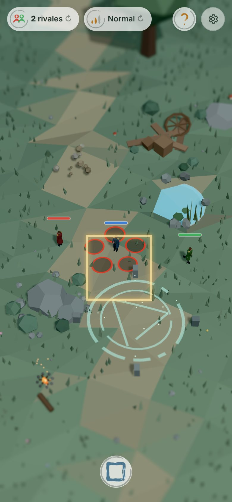
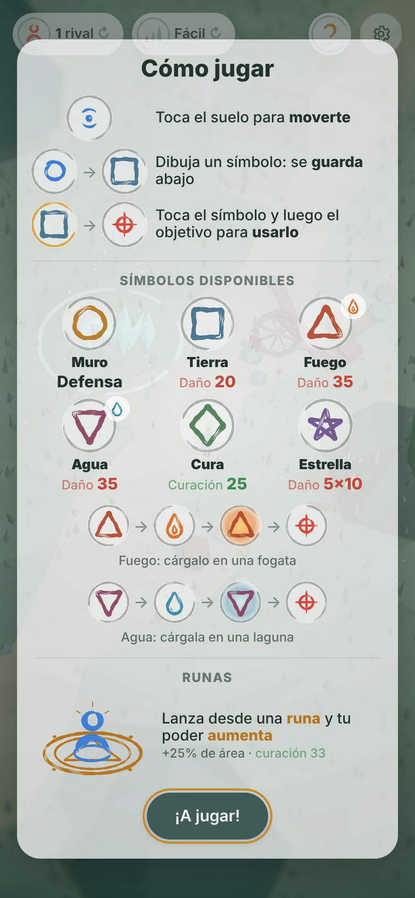
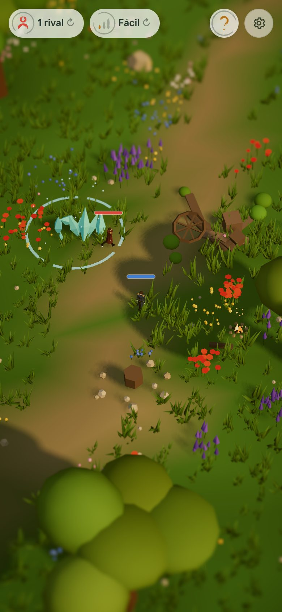

# Cirquimia

**Draw transmutation circles with your finger and duel rival alchemists in a tiny low-poly meadow.**

Cirquimia is a free, open-source browser game built for phones. You play a state alchemist dropped into a procedurally generated meadow that looks like a miniature diorama. Every attack, wall and heal comes from a symbol you draw on the screen: sketch a square and the earth erupts under your rival, draw a circle and a stone wall rises in front of you.

[**▶ Play it now: cirquimia.pages.dev**](https://cirquimia.pages.dev) · best on a phone in portrait; works with a mouse too.

<p align="center">
  
  
  
</p>

> **Status:** early prototype, under active development. The in-game text is in Spanish.

## Features

- **Draw to cast.** A geometric recognizer reads one-stroke shapes (circle, triangles, square, rhombus, pentagram) and snaps your ink to a clean symbol. No buttons, no menus.
- **A new meadow every match.** Terrain, trees, ponds, campfires, ruins and rune circles are generated from a seed, so each game is a different battlefield.
- **Rival alchemists.** Fight 0, 1 or 2 AI rivals in a free-for-all, on Fácil, Normal or Difícil. They walk, dodge, heal and draw their own symbols.
- **Use the terrain.** Fire must be charged at a campfire, water at a lagoon, and casting from inside a rune circle makes your spells stronger.
- **Miniature look.** Faceted low poly, the muted blue-green "Bruma" palette and a tilt-shift blur that makes the meadow feel like a tabletop model. An experimental warm "Glade" look is one toggle away.
- **Easy to pick up.** A visual "Cómo jugar" guide on first visit and a short interactive tutorial during the first match.
- **Fast on phones.** Instanced meshes (~15 draw calls for the whole meadow), one shadow light and a two-pass post effect.

## How to play

1. **Tap the ground** to walk.
2. **Draw a symbol** anywhere with one stroke. It is stored in the bar at the bottom (up to 6).
3. **Tap a stored symbol, then tap a target** to cast it.

| Symbol | Spell | Effect |
| --- | --- | --- |
| Circle | Muro (wall) | Raises an earth wall around you, facing where you tap; other fighters' strikes into its zone are blocked, yours go through |
| Square | Tierra (earth) | Stone pillars erupt at the target: 20 damage |
| Triangle ▲ | Fuego (fire) | 35 damage. Walk to a campfire (fogata) to charge it first |
| Triangle ▼ | Agua (water) | 35 damage. Charge it at the lagoon (laguna) first |
| Rhombus ◆ | Cura (heal) | Restores 25 HP |
| Pentagram ★ | Estrella (star) | Five strikes around the target, 10 damage each; good for hitting several rivals |

**Runes.** Cast from inside a rune circle on the ground and your power grows: +25% strike area, and heals restore 33 instead of 25.

A fighter at 0 HP falls. Knock out every rival for **¡Victoria!**; fall yourself and it is **Game Over**. Each new game starts on a new meadow. The two pills at the top left change the number of rivals and the difficulty; the **?** reopens the guide.

Handy URL parameters: `?seed=anything` reproduces a meadow, `?look=glade` switches to the Glade look, `?tutorial` replays the tutorial.

## Getting started

Requirements: Node.js 20.19+ or 22.12+ (what Vite 8 needs) and npm.

```bash
git clone https://github.com/glrodasz/cirquimia.git
cd cirquimia
npm install
npm run dev            # http://localhost:5173, also exposed on your LAN to test on a phone
```

| Command | What it does |
| --- | --- |
| `npm run dev` | Dev server with hot reload |
| `npm run build` | Type-checks and builds to `dist/` |
| `npm run build:single` | Builds `dist/cirquimia-single.html`, the whole game in one self-contained file |
| `npm run preview` | Serves the production build |

The gear button (top right) opens a developer panel: regenerate the meadow, set the seed, tweak generator sliders, toggle the tilt-shift and FPS counter, and switch the look.

### Deployment

`main` deploys automatically to [cirquimia.pages.dev](https://cirquimia.pages.dev) through Cloudflare Pages (`.github/workflows/deploy.yml`, using Wrangler). Every pull request gets its own preview URL (see the PR's "Deployments" link), and branch `foo/bar` is served at `https://foo-bar.cirquimia.pages.dev`. Deploys need the repo secrets `CLOUDFLARE_API_TOKEN` and `CLOUDFLARE_ACCOUNT_ID`; without them the workflow only builds.

## Tech stack

- **[Three.js](https://threejs.org/)** (WebGL) for rendering
- **[Vite](https://vite.dev/)** for the dev server and build
- **TypeScript**, no game engine and no runtime dependencies besides Three.js
- Planned: **[Capacitor](https://capacitorjs.com/)** to ship the same build as an iOS/Android app

## Project structure

| File | What it does |
| --- | --- |
| `src/main.ts` | Renderer, camera framing, lights, input, game loop |
| `src/generator.ts` | Procedural meadow: from a seed, picks and places features per material (roca, tierra, agua, fuego, magia, restos) plus a trail. Pure data, plus the generator parameters |
| `src/features.ts` | Builds each feature (menhir ring, wall, boulders, pond, campfire, crystals, rune circle, palisade, cart, logs, banner), batched into a few InstancedMeshes |
| `src/world.ts` | Generates/rebuilds the meadow, checks walkability (flood fill from the spawn) and drops the most blocking feature until enough is walkable |
| `src/meadow.ts` | Terrain, trees, rocks, grass, flowers, mushrooms (all instanced) |
| `src/look.ts` | Bruma (default) and Glade looks |
| `src/character.ts` | The alchemist: build, walk animation, obstacle sliding, falling and getting up |
| `src/path.ts` | Pathfinding around obstacles |
| `src/gestures.ts` | Single-stroke shape recognizer (geometry, no templates) |
| `src/ink.ts` | 2D overlay for the stroke, the shape snap and the flash |
| `src/ammo.ts` | Stored symbols bar: add, select, charge, spend |
| `src/spells.ts` | Spell visuals: earth wall, pillars, fire, water, heal, star |
| `src/combat.ts` | HP, damage, rune bonus, rival AI and difficulty levels, win/lose |
| `src/match.ts` | Match HUD (rivals, difficulty), end-of-match cards, restart on a new meadow |
| `src/help.ts` | "Cómo jugar" guide |
| `src/tutorial.ts` | Interactive first-match tutorial |
| `src/devtools.ts` | Gear button with the developer panel |
| `src/tiltShift.ts` | Miniature (tilt-shift) post effect |
| `src/marker.ts` | Ring shown where you tap |
| `src/noise.ts` | Seeded random and terrain height function |
| `estilos/` | Earlier visual style experiments (diorama, pixel art, engraving, palettes) |

## Roadmap

- [x] Procedural meadow, drawing recognizer, six spells
- [x] Rival alchemists, difficulty levels, Game Over / Victoria
- [x] First-visit guide and interactive tutorial
- [ ] A new shared meadow every 24 hours
- [ ] More biomes beyond the meadow
- [ ] Native mobile apps (iOS/Android) via Capacitor
- [ ] Multiplayer duels

Ideas and feedback are welcome in [Issues](https://github.com/glrodasz/cirquimia/issues).

## Contributing

Contributions of all sizes are welcome: bug reports, new symbols, balance tweaks, performance work, art.

1. Open an issue first for anything bigger than a small fix, so we can agree on the approach.
2. Fork the repo and create a branch from `main`.
3. Run `npm run build` before pushing; it type-checks the whole project.
4. Open a pull request with a short description and, for visual changes, a screenshot. The PR gets a preview deployment you can test on a phone.

Guidelines: keep the game fast on mid-range phones (prefer instancing, avoid extra render passes), keep it portrait-first, and keep new art in the faceted low-poly style.

## License

Cirquimia does not have a license file yet, so for now all rights are reserved by the author. A permissive license such as MIT is planned.

## Credits

Created by [@glrodasz](https://github.com/glrodasz). The alchemist and the transmutation-circle mechanic are inspired by classic alchemy fantasy; all art is original.

---

## Developer notes

### Tuning knobs

- Meadow generation: the gear (top right) opens the dev panel: new meadow, seed, material counts, densities, minimum walkable %, max animated elements. `?seed=texto` in the URL reproduces a meadow. Defaults in `DEFAULT_PARAMS` (`src/generator.ts`); playable area in `PLAY_AREA` (portrait only: everything is placed inside the vertical phone frame).

- Camera angle and zoom: `ELEVATION`, `AZIMUTH`, `FOV`, `VIEW_HEIGHT_LANDSCAPE`, `VIEW_WIDTH_PORTRAIT` in `src/main.ts`.
- Walk speed: `SPEED` in `src/character.ts`.
- Drawing vs tapping: `DRAW_THRESHOLD` in `src/main.ts`. Recognizer tolerances at the top of `src/gestures.ts`.
- Miniature blur: `band` and `strength` uniforms in `src/tiltShift.ts`.

### Performance choices

- Every repeated prop is one `InstancedMesh` (about 15 draw calls for the whole meadow).
- Flat-shaded Lambert materials, one shadow-casting light. The shadow box is fitted to the ground the screen shows and the map sized to keep the same texel size (48/1024 units on touch, 48/2048 on desktop), so shadows look the same at a fraction of the map.
- The camera never moves: instances farther than `VISIBLE_RADIUS` (`src/world.ts`) are dropped after generation.
- Scene is drawn once into a 4x MSAA half-float target (no canvas MSAA); horizontal blur, then vertical blur straight to the canvas, which also tone maps (no separate output pass). Inside the focus band the blur reads one texel.
- Pixel ratio capped at 2; the tilt-shift pass can be toggled off from the dev panel.
